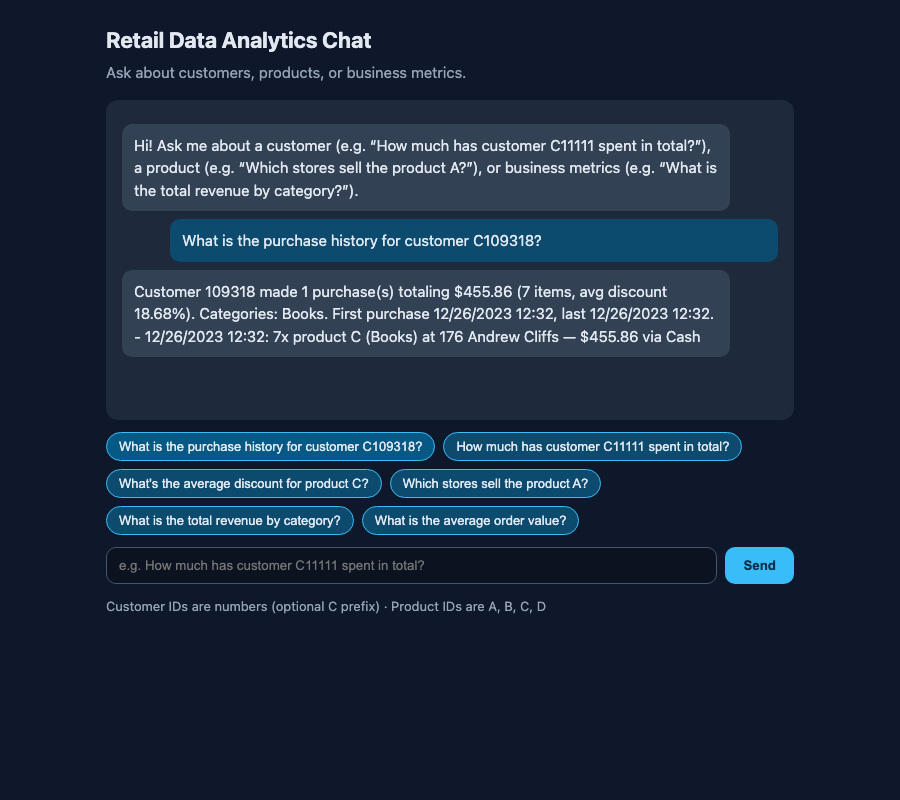
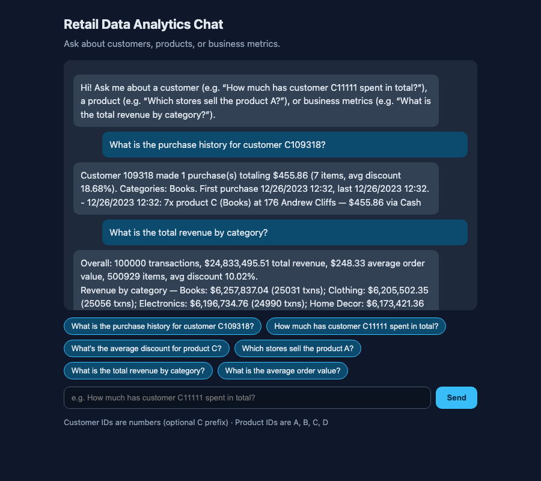

# Retail Data Analytics Chat System

AI-powered conversational analytics over the
[Kaggle Retail Transaction Dataset](https://www.kaggle.com/datasets/fahadrehman07/retail-transaction-dataset/data)
(100,000 transactions). Ask about a **customer**, a **product**, or **business metrics** in plain English;
the system parses intent, queries SQLite, and answers in natural language — with an optional LLM
(OpenAI / Anthropic / Ollama) used only to rephrase the grounded answer, never to invent numbers.




## Quickstart (local run)

```bash
cd retail-data-analytics-chat
python3 -m venv .venv && source .venv/bin/activate
pip install -r requirements.txt

# Load data (uses the full Kaggle CSV if cached, else the bundled sample)
python scripts/init_db.py

# Start the backend + chat UI
uvicorn app.main:app --port 8137
# open http://localhost:8137 in a browser
```

Run the tests:

```bash
LLM_PROVIDER=off python -m pytest tests/ -q
```

## Dataset setup

| Option | How |
|---|---|
| Full 100k rows (recommended) | `pip install kagglehub`, then `python scripts/init_db.py` (downloads `fahadrehman07/retail-transaction-dataset` automatically). Or download `Retail_Transaction_Dataset.csv` from Kaggle manually and run `python scripts/init_db.py --csv /path/to/Retail_Transaction_Dataset.csv` |
| Offline sample (default) | Just run `python scripts/init_db.py` with no cache/Kaggle access — it falls back to `data/sample_transactions.csv` (9 rows, same schema). The API also auto-seeds this on first request if no DB exists. |

Columns: `CustomerID, ProductID, Quantity, Price, TransactionDate, PaymentMethod, StoreLocation, ProductCategory, DiscountApplied(%), TotalAmount`, loaded into a SQLite `transactions` table (indexed on customer, product, category).

> **ID formats — please read:** the real dataset does not use the `C…`/`P…` style IDs from the
> assignment examples. Real `CustomerID`s are plain numbers (e.g. `109318`) and `ProductID`s are
> single letters (`A`, `B`, `C`, `D`). This system accepts **both**: `C109318` works the same as
> `109318`, and `P9999`-style IDs are routed to the product lookup, which replies “not found” and
> lists the valid IDs (`A, B, C, D`) instead of misrouting.

## Environment variables

No keys are required — without any provider configured the system answers from built-in
templates over real query results (this is also how the test suite runs). To enable LLM
rephrasing, copy `.env.example` to `.env` and set **one** of:

| Variable | Effect |
|---|---|
| `OPENAI_API_KEY` (+ optional `OPENAI_MODEL`, default `gpt-4o-mini`) | Rephrase answers with OpenAI |
| `ANTHROPIC_API_KEY` (+ optional `ANTHROPIC_MODEL`, default `claude-3-5-haiku-latest`) | Rephrase answers with Anthropic |
| `OLLAMA_HOST` (+ optional `OLLAMA_MODEL`, default `llama3.1`) | Rephrase with a local Ollama model |
| `LLM_PROVIDER=off` | Force template answers even when a key is set |
| `RETAIL_DB` | SQLite path (default `data/retail.db`) |
| `RETAIL_CSV` | CSV used by `scripts/init_db.py` when no `--csv` is given |

## Example queries to test

These work against the bundled sample DB (expected answers in brackets):

- “What is the purchase history for customer C109318?” → 2 purchases, $545.86 total
- “How much has customer C11111 spent in total?” → $157.00 across 2 purchases
- “What's the average discount for product C?” → 16.40%
- “Which stores sell the product A?” → 3 stores, $254.52 revenue
- “What is the total revenue by category?” → $1,412.19 overall + per-category breakdown
- “What is the average order value?” → business metrics
- “Who are the top customers by spend?” → ranked top-5
- “Which stores sell the product P9999?” → graceful not-found + valid IDs
- “How much has customer C99999 spent?” → graceful not-found

(On the full 100k-row DB the same queries run; e.g. customer `109318` has a single
$455.86 purchase there, and sample-only IDs like `11111` report “not found” with guidance.)

## Architecture

- `app/db.py` — SQLite data-access layer: customer lookups/summaries, product
  summaries (avg discount, store count + sample), business aggregations
  (revenue by category/payment, top customers), with optional category/payment filters.
- `app/nlp.py` — deterministic intent classification (`customer` / `product` /
  `business` / `ambiguous` / `help` / `unknown`) + entity extraction
  (customer/product IDs, category, payment method, top-N). Rule-based so routing is
  exact and unit-testable.
- `app/llm.py` — optional LLM rephrasing chain (OpenAI → Anthropic → Ollama →
  offline template). The LLM only rewords precomputed evidence.
- `app/chat.py` — orchestrator: parse → query → phrase; handles invalid IDs,
  missing IDs, ambiguous (“customer 11111 with product C”), and empty results.
- `app/main.py` — FastAPI REST API (`/api/customers/{id}[/summary]`,
  `/api/products/{id}[/summary]`, `/api/metrics`, `/api/chat`, `/api/health`,
  `/api/examples`) serving the chat UI in `static/`.
- `scripts/init_db.py` — CSV → SQLite loader (Kaggle cache → `--csv` → sample fallback).
- `tests/` — 30 tests: `test_nlp.py` (intent/entities), `test_db.py` (data layer),
  `test_chat.py` (end-to-end chat + REST flows, incl. invalid-ID edge cases).

## Submission

```bash
git init && git add -A && git commit -m "Retail analytics chat system"
# push to GitHub, then share repository access with gensparkreviewer@gmail.com
```
